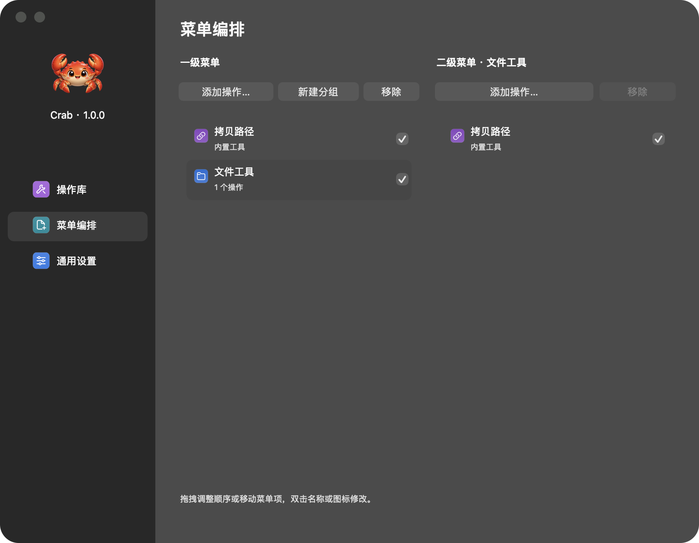

# Crab

Crab 是一款原生 macOS 访达右键扩展工具。

## 界面预览




## 开始使用

1. 构建并打开 Crab，在通用设置的权限区域打开扩展管理，启用 **Crab Finder 菜单**。
2. 在“操作库”使用预置操作，或展开“新增操作…”直接选择类型，选取文件、目录、应用、图片或脚本；文件和目录支持多选添加。
3. 在“菜单编排”新建分组并添加操作，也可以右键操作卡片选择“加入菜单…”。新建分组直接插入列表并进入名称编辑；拖拽调整位置，双击修改菜单名称，双击行首图标选择内置图标，行末复选框控制是否显示。
4. 回到访达，在对应文件或目录上打开右键菜单。

## 从源码构建

需要 macOS 13 或更新版本以及完整 Xcode 工具链。在项目根目录执行：

```sh
bash Scripts/build.sh
open build/Build/Products/Release/Crab.app
```

## 使用提示

- 应用入口需要安装对应应用；脚本需要相应解释器。脚本引用原文件，不修改内容或执行权限，执行结束的错误提示沿用当前脚本规则。
- ZIP 与 7z 的支持范围见[编解码说明](Support/NativeCodecs.md)。
- “显示隐藏文件 / 不显示隐藏文件”会重启访达以应用设置。
- iCloud 与 OneDrive 中的备用菜单触发方式在通用设置中配置，需要对应权限。

## 许可

遵循 [Crab Noncommercial Source License 1.0](LICENSE)。个人非商用免费；传播须免费公开完整源码，修改版沿用本协议；商用须事先取得书面授权。。

## 致谢

- **libwebp**：提供无损 WebP 编码支持。
- **libarchive**：通过 macOS 系统库提供 7z 解码支持。
